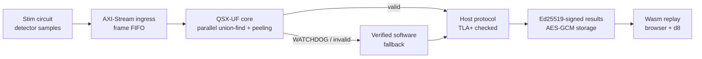
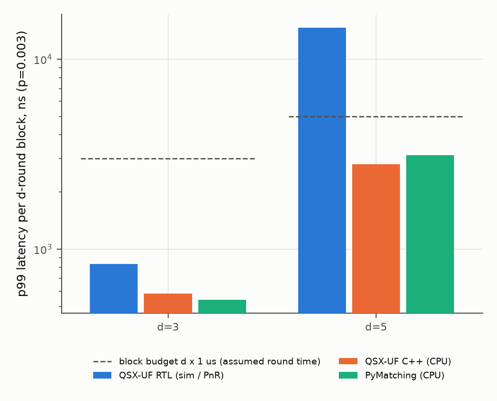
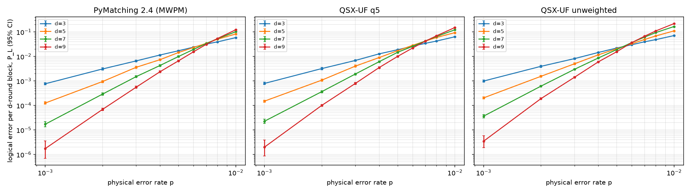
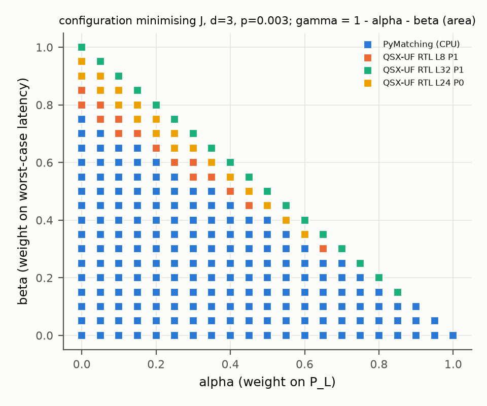
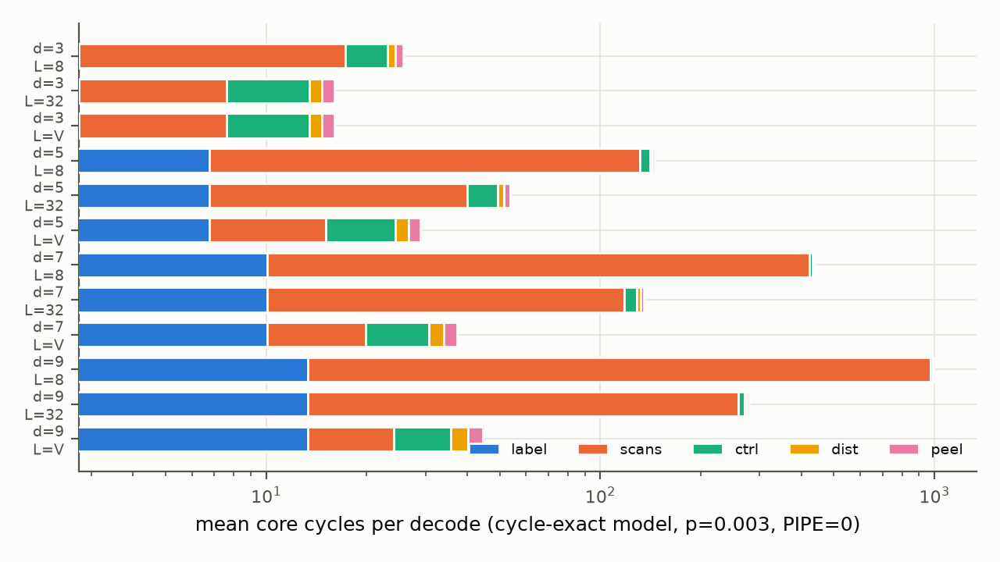

<div align="center">

# QShield-X

**A formally verified, FPGA-targeted union-find decoder for the surface code, and a measured answer to whether
hardware beats software.**

[](https://github.com/eshaan2418/qshield-x/actions/workflows/ci.yml)


</div>

A union-find decoder for the surface code, written as SystemVerilog and checked formally, targeting an FPGA. It
is built together with a bit-exact C++ golden model, a WebAssembly runtime, and a fix to V8's arm64 code generation.

> Every number below is rendered from `results/` by `bench/claims.py` (`make check-numbers` fails on any
> number without a source). Hardware numbers carry their evidence stage. **No number comes from a physical
> FPGA board or an ASIC.**

## The question and the answer

*Does hardware–software co-design with formally checked execution protocols give a better logical-error /
latency / resource trade-off than a fixed software decoder?* (rotated surface-code memory, uniform
circuit-level depolarizing noise, d = 3–9)

**Mixed, and mostly negative on raw speed for this device class.**

* **Typical latency: no gain.** At d = 3, p = 0.003 the best placed RTL configuration has p99 833 ns
  per d-round block [sim cycles / pnr Fmax], against 0.54 µs for PyMatching on one CPU core
  [CPU measurement (1 thread)] (ratio 1.54). At d = 5 only narrow-scan configurations fit the
  LFE5U-85F, at 32.6 MHz: p99 14,610 ns against 3.12 µs.
* **Worst case: a real gain, and a guaranteed one.** The RTL's observed maximum at d = 3 is 941 ns,
  against 4.75 µs on the CPU. The bound is proven: the watchdog property (C2) and the shell
  properties guarantee that a frame over budget returns `WATCHDOG` and goes to the verified software fallback,
  never a wrong valid result. Against a d × 1 µs block deadline (an assumed round time), the hardware finishes
  100.0 % of d = 3 frames and 7.5 % of d = 5 frames itself.
* **Accuracy: a cost that grows with d.** QSX-UF (3-bit weights) P_L is 1.28× PyMatching's at d = 7
  and 1.42× at d = 9, p = 0.003 [sim (Monte Carlo, Stim)]. Threshold crossings (d = 7/9):
  0.0072 vs 0.0078.
* **Area: the binding constraint.** The fully parallel fabric needs 60,840 LUT4 at d = 5
  (99 % of the device after PnR); every d ≥ 7 configuration exceeds the device. In-cycle
  accounting points to the next design: at LANES = 8 the serial scans take 94 % of all cycles
  at d = 7 [sim (cycle-exact HwModel)].

* **The objective, evaluated.** For J = α·P_L + β·T + γ·A over every measured configuration, an RTL configuration
  is optimal for 0 % of weightings when T is p99 latency, and for 23 %
  when T is worst-case latency (d = 3) [analysis of measured configs (weight sweep)]. Co-design pays off exactly when the deadline
  is what matters.

## Architecture



The RTL core matches the C++ `HwModel` bit for bit and cycle for cycle, and the Wasm build matches the native
decoder bit for bit. The shell properties and the core's interface guarantees (d = 3, 5, 7) are proven by
k-induction, and the host protocol is model-checked with TLC.

## Figures

| Latency per d-round block | Logical error rate vs physical error rate |
|:---:|:---:|
|  |  |
| **Where J = α·P_L + β·T + γ·A is minimised (worst-case T)** | **Where the cycles go** |
|  |  |

## What's here

| Area | What | Evidence |
|------|------|----------|
| Algorithm | QSX-UF: Jacobi-synchronous UF with canonical BFS peeling (bit-exact parallel ↔ sequential) | `DECISIONS.md` D1 |
| Software baselines | Stim memory experiments d = 3–9, PyMatching 2.4 vs QSX-UF, exact binomial CIs | `results/M1/` |
| RTL | `rtl/`: parameterised core (LANES, PIPE), AXI-Stream shell, frame FIFO, atomic config, watchdog | `rtl/README.md` |
| Co-simulation | 3,840,000 + 1,040,000 syndromes, 0 mismatches (bitmap + cycles) | `results/M2/cosim*/` |
| FPGA | Yosys + nextpnr-ecp5, LFE5U-85F | `results/M2/fpga/`, `results/M2/report.json` |
| Formal | SVA/SymbiYosys k-induction (shell; real core at d = 3, 5, 7), TLA+/TLC (liveness counterexample found and fixed), Z3 step equivalence | `results/M3/`, `formal/README.md` |
| Wasm | native vs Wasm scalar vs Wasm SIMD128 in Node, d8, Chrome; bit-exact | `results/M4/` |
| V8 | arm64 `v128.any_true` → `cbz/cbnz` fusion: patch, unittests, mjsunit test | `v8/`, `results/M5/` |
| Learned/adaptive | GNN decoder, noise-shift adaptive policy vs fixed and oracle | `results/M6/` |
| Federated | FedAvg, DP-SGD (RDP accountant), pairwise-mask secure aggregation, 3 sites | `results/M7/` |
| Infra | Ed25519-signed traces and manifests, AES-256-GCM storage, mTLS control API, negative tests | `infra/`, `results/M8/` |
| Browser view | live Wasm decoding, lattice, running P_L, RTL cycles, in-browser signature verification + replay | `viz/` |
| Objective | J = α·P_L + β·T + γ·A over all measured configurations: Pareto set and weight sweep | `results/M10/objective.json` |
| End to end | Stim → RTL (Verilator) → verified fallback → signed results → Wasm replay | `bench/e2e_demo.py`, `results/M10/` |

## Selected results

* RTL vs golden model: 0 mismatches over 3,840,000 syndromes, d = 3, 5, 7 [sim (Verilator RTL vs C++ golden model)].
* Formal: 17 of 17 formal jobs pass as expected (mutants must fail). Details are in
  `results/M3/formal_summary.json`.
* The verified shell costs 2.9 % of LUT4 at d = 5 [synth (Yosys synth_ecp5 -noflatten)] and
  16.0 cycles per frame [sim (Verilator qsx_top)].
* V8 patch: every `v128.any_true` branch drops from 5 to 3 instructions. A zero-block scan microbenchmark runs at
  0.85× the unpatched time [d8 measurement (interleaved A/B, median)]. In the decoder itself the effect is within
  noise (unpack kernel 1.01×, 95% CI 0.96–1.02).
  2,955 V8 tests pass, and the new test fails on a mutated lowering.
* Wasm SIMD128 vs native NEON at d = 5: 1.22× steady-state time [CPU measurement (d8 vs native)].
* End-to-end demo: 4,831 rounds committed from hardware and 169 from the software fallback, including
  50 injected lost responses. The Wasm replay reproduces the signed predictions: yes.

## Reproduce

```
source env.sh            # project-local toolchains (see ENVIRONMENT.md)
make test                # C++ golden model + Python + infra tests
make ci                  # lint, tests, quick co-simulation, quick formal
make reproduce-quick     # < 1 h: rebuild, reduced experiments, figures, number cross-check
make reproduce-full      # every experiment (many hours; FPGA d >= 7 needs > 16 GB RAM)
make timing              # all timing-sensitive measurements in one quiet window (records load average)
make viz                  # browser view at http://127.0.0.1:8765/viz/ (live Wasm decoding, signed-result replay)
make paper               # paper/qshieldx.pdf (12 pages; every number is a \claim from results/)
```

## Limitations

See `FINAL_REVIEW.md` and §Limitations of the paper. In short: there's no board, so latency is
cycle-exact simulation divided by post-PnR Fmax. k-induction of the real core covers d = 3, 5 and 7 (LANES = 8). The noise is
uniform circuit-level depolarizing noise. The federated study is a single-process simulation.

## Layout

`sim/` graphs and circuits · `decoders/` C++ golden model + Python bindings · `rtl/` SystemVerilog · `tb/`
Verilator testbenches · `formal/` SVA, TLA+, Z3 · `fpga/` open-flow scripts · `wasm/` Emscripten builds +
harness · `v8/` patch, reduced cases, analysis · `learned/` GNN and adaptive policy · `federated/` ·
`infra/` signing/encryption/mTLS · `viz/` browser view · `bench/` runners, statistics, plots, claims · `paper/` · `results/`
